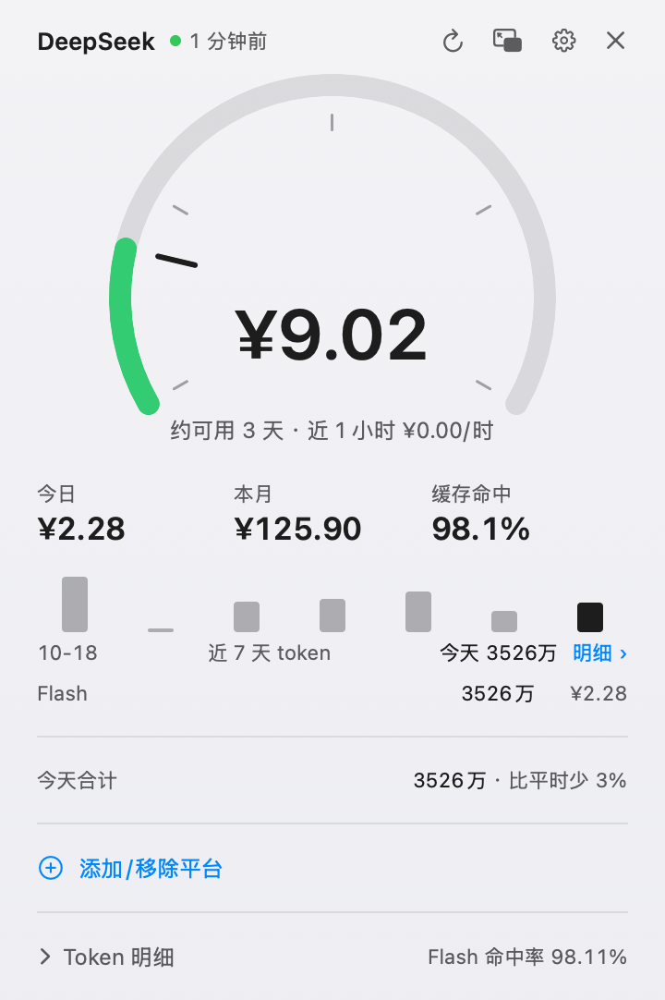
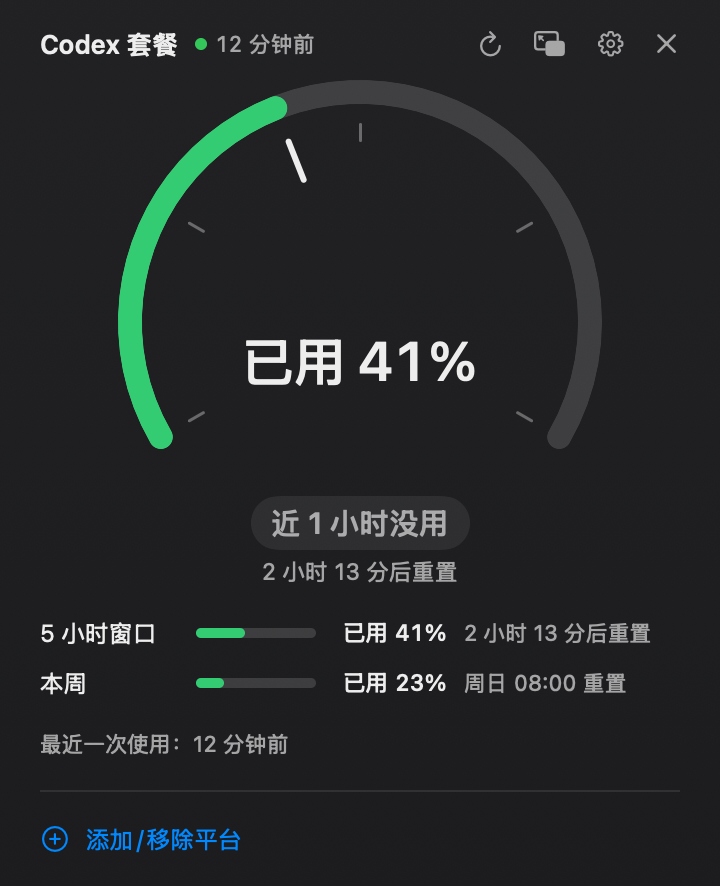
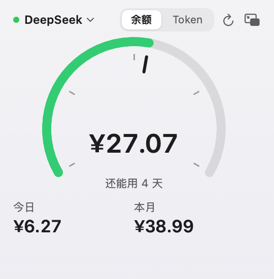
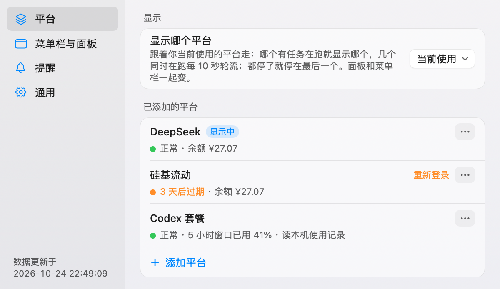

# Token Bar

[中文](#中文) · [English](#english)

---

## 中文

Token Bar 是一个 macOS 菜单栏小工具：在菜单栏里一眼看到 AI 平台还剩多少钱、还剩多少额度、照现在的速度还能用多久。

- **按量付费**：DeepSeek、硅基流动——余额、今日 / 本月花费、近 7 天各模型 token 用量。
- **套餐额度**：Claude（Pro / Max）、Codex（ChatGPT 套餐）——5 小时窗口和每周额度已用多少、下次什么时候重置。
- **还能撑多久**：按最近的消耗速度估算剩余可用时间，快用完时提醒（系统通知 + 面板顶部提醒条）。
- **正在跑的任务**：列出本机 Claude Code / Codex 进行中的会话（项目名、模型、已写 token）。
- 菜单栏、点开的面板、可以挂在桌面上的小组件三种看法；深色 / 浅色跟随系统。

### 截图

<p>


</p>
<p>


</p>

（截图用的是示例数据。）

### 系统要求

- macOS 14（Sonoma）或更新
- Apple 芯片和 Intel 都可以（安装包是通用版）

### 安装

1. 到 [Releases](../../releases) 下载最新的 `TokenBar-<版本>.dmg`。
2. 打开 dmg，把 **TokenBar** 拖进「应用程序」。
3. 从「应用程序」里打开 Token Bar，菜单栏会出现它的图标；第一次会带你选平台、连账号。

（可选）核对下载的文件没被改过：Release 页面写了 dmg 的 SHA-256，终端里跑 `shasum -a 256 ~/Downloads/TokenBar-*.dmg` 对一下。

#### 第一次打开被 macOS 拦住怎么办

Token Bar 没有 Apple 开发者签名和公证（作者没有付费开发者账号），所以第一次打开时 macOS 会提示「无法验证 Token Bar 是否包含恶意软件」之类的话，**这是正常的**。macOS 15 起右键「打开」已经不能绕过，请这样做：

1. 先双击打开一次，看到提示后点「完成」（或「取消」）。
2. 打开「系统设置 → 隐私与安全性」，滚到最下面，会看到「已阻止使用 Token Bar」，点旁边的 **「仍要打开」**，输入登录密码确认。
3. 再打开一次 Token Bar，弹窗里点「打开」。以后就不会再问了。

备选（熟悉终端的话）：去掉「从网上下载」的标记，然后正常打开：

```bash
xattr -dr com.apple.quarantine /Applications/TokenBar.app
```

#### 钥匙串授权

你填的 API Key、网页登录凭证都存在 macOS 钥匙串里。读写钥匙串时 macOS 可能会弹框问「Token Bar 想要使用钥匙串中的机密信息」：输入登录密码，点 **「始终允许」**。

#### 升级

下载新版 dmg，拖进「应用程序」覆盖旧版即可，设置和数据都会保留。

**升级后会再问一次钥匙串**，点「始终允许」就好。原因：Token Bar 是 ad-hoc 签名（没有开发者证书），每个版本的签名都不一样，钥匙串会把新版本当成新程序。这是没有付费开发者账号的硬限制，代码里绕不过去。

### 隐私

Token Bar **不收集、不上传任何数据**：没有统计、没有崩溃上报、没有自己的服务器。下面是它在你电脑上做的全部事情。

**联网（只连这些地址）**

| 地址 | 做什么 |
|---|---|
| `api.deepseek.com`、`platform.deepseek.com` | DeepSeek 余额、用量（用你填的 API Key / 控制台登录凭证） |
| `bill.siliconflow.cn`、`walletd.siliconflow.cn`、`cloud.siliconflow.cn` | 硅基流动余额、账单（用你的控制台登录凭证） |
| `api.frankfurter.dev` | 美元兑人民币汇率（欧洲央行数据，每天最多一次） |
| `api.github.com` | 检查更新：看 GitHub 上 Token Bar 的最新版本号（匿名请求，不带任何账号信息，每天最多一次；有新版本只在设置页和右键菜单提示，不自动下载）。设置 → 通用 →「自动检查更新」可以关掉 |

Claude、Codex 的额度不由 Token Bar 联网获取，而是读本机文件和本机命令行（见下）。右键菜单里「打开 … 用量页」只是用你的浏览器打开对应平台的网页。

**网页登录**：DeepSeek、硅基流动的「控制台登录」在 App 内一个一次性网页窗口里完成，窗口不保留任何登录状态（不写 cookie 到磁盘），只把需要的那一个凭证存进钥匙串。

**钥匙串**：一条通用密码，名字是 `com.lemon.deepseek-tokenbar.all`，里面是你添加的平台的 API Key、网页登录凭证（及其过期时间）、硅基流动账号编号。不开 iCloud 同步。

**读本机文件（只读）**

- `~/.claude/projects/` 下 Claude Code 的会话记录、`~/.codex/sessions/` 下 Codex 的会话记录：只取模型名、token 数、时间戳、额度读数，以及会话所在文件夹的名字（显示「正在跑的任务」用）；**对话内容一律不解码、不保存、不写日志**。
- `~/Library/Application Support/Claude/plan-usage-history.json`：Claude 桌面 App 自己记的套餐额度。

**会改动的本机文件**

- ⚠️ **`~/.claude/settings.json` 的 `statusLine`**：只有在你添加 Claude 套餐、选「终端版（Claude Code）」并点安装时才会改。Token Bar 装一个状态栏钩子，钩子把额度写进 Token Bar 自己的文件，同时**原样转发你原来的 statusLine 命令**，你看到的状态栏不变。安装前会把原值备份；在设置里移除 Claude 套餐时会还原成安装前的样子。
- `~/Library/LaunchAgents/com.lemon.deepseek-tokenbar.alive.plist`：开机自动启动、异常退出后自动拉起。设置 → 通用 →「开机自动启动」可以关掉（关掉会删除这个文件）。
- `~/Library/Application Support/TokenBar/`：采样记录（SQLite）、上次的数据快照、状态栏钩子脚本和额度文件、命令行查询用的固定工作目录。
- `~/Library/Logs/TokenBar/app.log`：运行日志（1 MB 滚动一份；不写 key、token）。

**会启动的程序**

- `claude -p /usage`：Claude 套餐选「桌面 App」来源时，定期跑一次你本机已安装的 Claude Code 命令行读取额度（本地命令，不调用模型、不花钱；登录由 claude 自己处理，Token Bar 不读它的登录文件）。它会在 `~/.claude/projects/` 下建一个对应固定工作目录的空文件夹。
- `launchctl`：注册 / 注销上面的开机自启。

### 遇到问题

打开设置 → 通用，点「诊断信息」那一行的 **复制** 按钮（「复制诊断信息」），把内容贴到 [Issues](../../issues) 里。诊断信息包含版本、系统版本、各平台状态和最近的日志，复制前已经把 key / token 打码。

### 从源码编译

需要 macOS 14+ 和 Xcode 或 Command Line Tools（`xcode-select --install`），不需要打开 Xcode 工程：

```bash
bash app/test.sh
```

```bash
bash app/build.sh
```

`build.sh` 会编译并装到 `~/Applications/TokenBar.app`；只编译不安装加 `--no-install`，编通用版加 `--universal`。更多见 [CONTRIBUTING.md](CONTRIBUTING.md)。

### 卸载

1. 先在设置 → 通用里关掉「开机自动启动」，再在菜单栏图标上右键 →「退出 Token Bar」。
2. 如果装过 Claude 状态栏钩子，先在设置里移除 Claude 套餐（会还原 `~/.claude/settings.json`）。
3. 删除 `/Applications/TokenBar.app`、（如果还在）`~/Library/LaunchAgents/com.lemon.deepseek-tokenbar.alive.plist`、`~/Library/Application Support/TokenBar/`、`~/Library/Logs/TokenBar/`；钥匙串里的 `com.lemon.deepseek-tokenbar.all` 可在「钥匙串访问」里删除。

### 许可与声明

[MIT](LICENSE)。

Token Bar 是个人开源项目，与 Anthropic、OpenAI、DeepSeek（深度求索）、硅基流动没有任何关联，也未获得它们的认可。Claude、Codex、ChatGPT、DeepSeek、硅基流动等名称和商标归各自所有者所有。App 里的平台小图标是作者自己画的示意图形，不是官方标志。

---

## English

Token Bar is a macOS menu bar app that shows how much money or quota you have left on your AI platforms, and how long it will last at your current pace.

- **Pay-as-you-go**: DeepSeek and SiliconFlow — balance, today's / this month's spend, 7-day token usage by model.
- **Plan quotas**: Claude (Pro / Max) and Codex (ChatGPT plans) — how much of the 5-hour and weekly limits you've used, and when they reset.
- **Runway**: estimates remaining time from recent burn rate and alerts you before you run out (system notification + banner in the panel).
- **Running tasks**: lists in-progress Claude Code / Codex sessions on this Mac (project, model, tokens written).
- Menu bar, a pop-up panel, and an optional floating desktop widget; follows system light / dark mode.

> The interface follows your system language: Chinese if your preferred language is Chinese, English otherwise.

### Screenshots

See the screenshots in the Chinese section above (sample data).

### Requirements

- macOS 14 (Sonoma) or later
- Apple silicon or Intel (the download is a universal binary)

### Install

1. Download the latest `TokenBar-<version>.dmg` from [Releases](../../releases).
2. Open the dmg and drag **TokenBar** into Applications.
3. Open Token Bar from Applications. Its icon appears in the menu bar and a short setup guides you through adding platforms.

Optional: compare the dmg's SHA-256 with the one on the Release page: `shasum -a 256 ~/Downloads/TokenBar-*.dmg`.

#### If macOS blocks the first launch

Token Bar is not signed with an Apple Developer ID or notarized, so macOS will say it cannot verify the app. **This is expected.** On macOS 15 and later, right-click → Open no longer bypasses it. Instead:

1. Try to open the app once and dismiss the warning.
2. Go to **System Settings → Privacy & Security**, scroll to the bottom, and click **Open Anyway** next to the Token Bar message. Confirm with your password.
3. Open Token Bar again and click **Open**. You won't be asked again.

Alternative (Terminal): remove the "downloaded from the internet" flag, then open the app normally:

```bash
xattr -dr com.apple.quarantine /Applications/TokenBar.app
```

#### Keychain prompt

API keys and web login tokens are stored in the macOS Keychain. macOS may ask whether Token Bar can use confidential information from the keychain — enter your login password and click **Always Allow**.

#### Updating

Download the new dmg and drag it over the old app; settings and data are kept. **You will be asked for keychain access once more after each update** — click Always Allow. Because the app is ad-hoc signed (no developer certificate), each build has a different signature and the Keychain treats it as a new program. This can't be worked around without a paid Apple Developer account.

### Privacy

Token Bar **collects and uploads nothing**: no analytics, no crash reporting, no server of its own. This is everything it does on your Mac.

**Network (only these hosts)**

| Host | Purpose |
|---|---|
| `api.deepseek.com`, `platform.deepseek.com` | DeepSeek balance and usage (with your API key / console login token) |
| `bill.siliconflow.cn`, `walletd.siliconflow.cn`, `cloud.siliconflow.cn` | SiliconFlow balance and bills (with your console login token) |
| `api.frankfurter.dev` | USD→CNY exchange rate (ECB data, at most once a day) |

Claude and Codex quotas are read from local files and the local CLI, not fetched by Token Bar over the network. The right-click menu item that opens a platform's usage page simply opens it in your browser.

**Web login**: DeepSeek / SiliconFlow console logins happen in a one-off in-app web window that keeps no login state on disk; only the one credential needed is saved to the Keychain.

**Keychain**: one generic password item named `com.lemon.deepseek-tokenbar.all`, holding the API keys, web login tokens (and their expiry) and SiliconFlow account ID for the platforms you add. Not synced to iCloud.

**Files read (read-only)**

- Claude Code session logs under `~/.claude/projects/` and Codex session logs under `~/.codex/sessions/`: only model names, token counts, timestamps, quota readings, and the name of the session's folder (for "running tasks"). **Conversation content is never decoded, stored or logged.**
- `~/Library/Application Support/Claude/plan-usage-history.json`: quota history recorded by the Claude desktop app.

**Files modified**

- ⚠️ **`statusLine` in `~/.claude/settings.json`** — only if you add the Claude plan, choose the terminal (Claude Code) source, and click install. Token Bar installs a status line hook that writes quota readings to Token Bar's own file and **forwards your existing statusLine command unchanged**, so your status line looks the same. The original value is backed up and restored when you remove the Claude plan in Settings.
- `~/Library/LaunchAgents/com.lemon.deepseek-tokenbar.alive.plist`: launch at login and restart after a crash. Turn it off in Settings → General (this deletes the file).
- `~/Library/Application Support/TokenBar/`: sample history (SQLite), last data snapshot, the status line hook script and its quota file, a fixed working directory for CLI queries.
- `~/Library/Logs/TokenBar/app.log`: app log (rotated at 1 MB; never contains keys or tokens).

**Processes started**

- `claude -p /usage`: when the Claude plan uses the desktop-app source, Token Bar periodically runs your locally installed Claude Code CLI to read quota (a local command — no model call, no cost; claude handles its own login, Token Bar never reads its credential files). This creates an empty folder under `~/.claude/projects/` for the fixed working directory.
- `launchctl`: to register / unregister launch at login.

### Troubleshooting

Open Settings → General and click the **copy** button on the Diagnostics ("诊断信息") row and paste it into an [issue](../../issues). It contains the app and macOS versions, platform status and recent log lines, with keys and tokens redacted.

### Build from source

Requires macOS 14+ and Xcode or the Command Line Tools (`xcode-select --install`); no Xcode project involved.

```bash
bash app/test.sh
```

```bash
bash app/build.sh
```

`build.sh` builds and installs to `~/Applications/TokenBar.app`; add `--no-install` to only build, `--universal` for an arm64 + x86_64 binary. See [CONTRIBUTING.md](CONTRIBUTING.md).

### Uninstall

1. Turn off launch at login in Settings → General, then right-click the menu bar icon → Quit Token Bar.
2. If you installed the Claude status line hook, remove the Claude plan in Settings first (restores `~/.claude/settings.json`).
3. Delete `/Applications/TokenBar.app`, (if still there) `~/Library/LaunchAgents/com.lemon.deepseek-tokenbar.alive.plist`, `~/Library/Application Support/TokenBar/`, `~/Library/Logs/TokenBar/`; remove the `com.lemon.deepseek-tokenbar.all` item in Keychain Access if you like.

### License & disclaimer

[MIT](LICENSE).

Token Bar is an independent open-source project. It is not affiliated with, endorsed by, or sponsored by Anthropic, OpenAI, DeepSeek or SiliconFlow. Claude, Codex, ChatGPT, DeepSeek, SiliconFlow and related names are trademarks of their respective owners. Platform icons in the app are the author's own simple drawings, not official logos.
